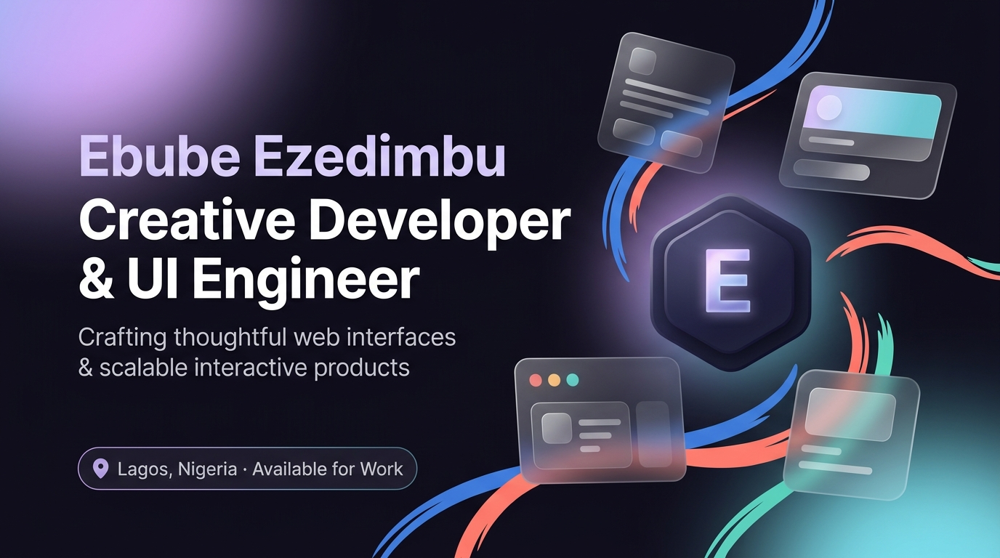
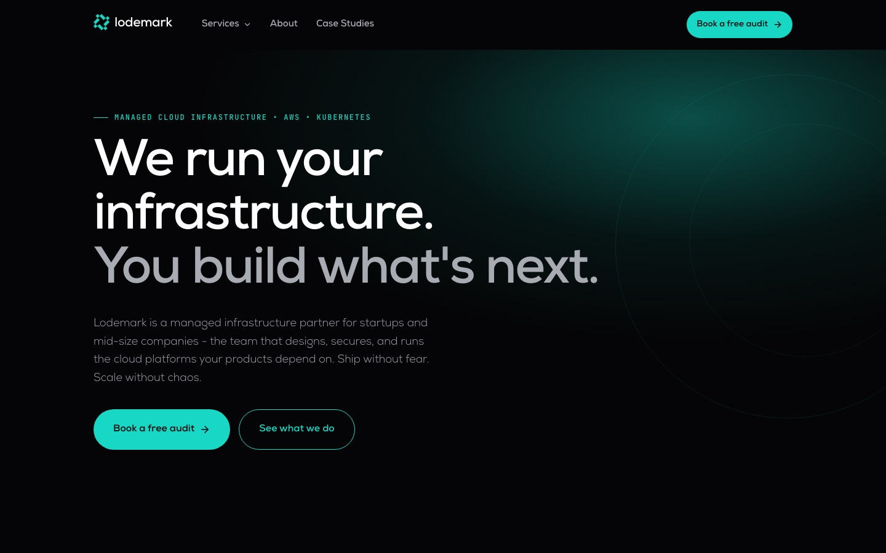
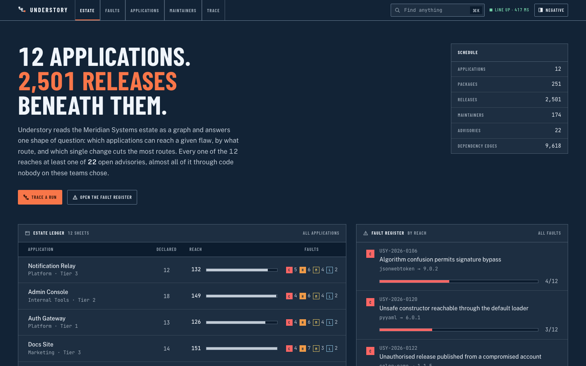
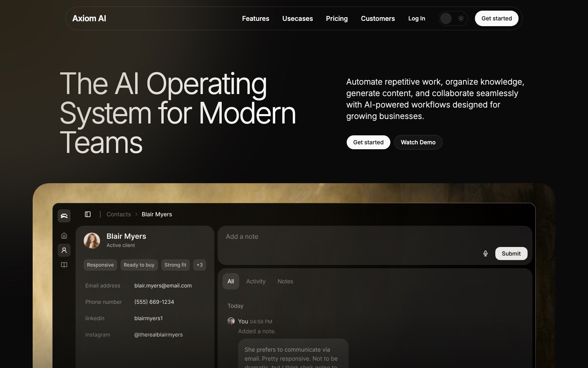
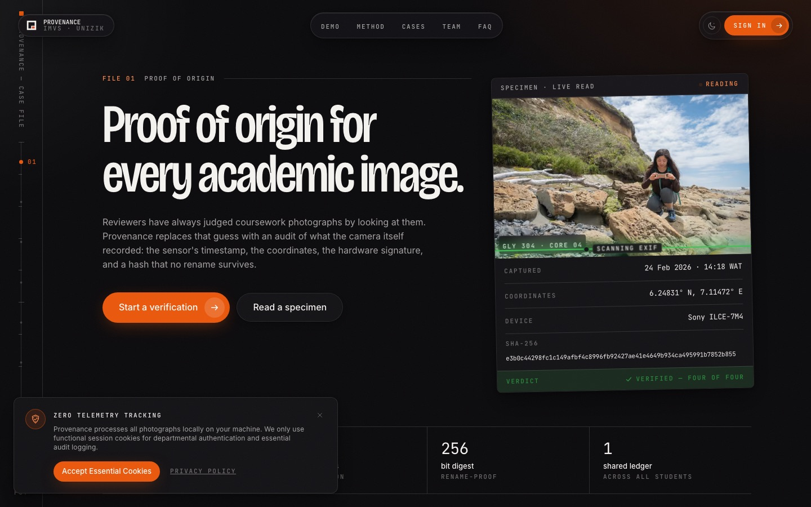
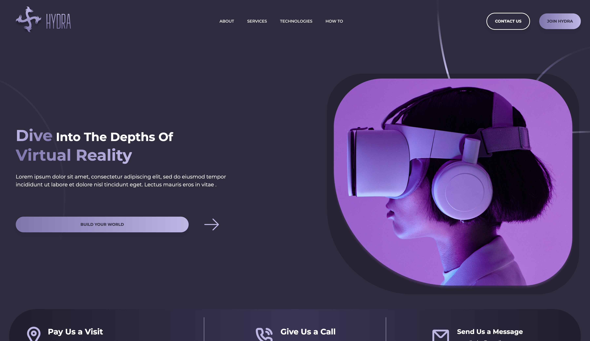
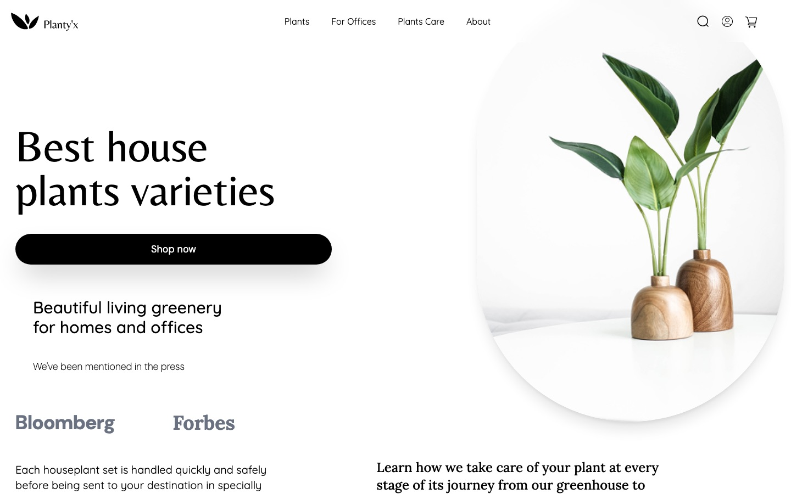

<div align="center">



# iSyncPlus

### Creative developer · UI engineer · product-minded builder

I design and build expressive digital experiences where **strong visual systems**, **thoughtful interaction**, and **reliable engineering** meet.

<p>
  <a href="https://ebube-eze.vercel.app/"></a>
  <a href="https://www.linkedin.com/in/ebube-ezedimbu/"></a>
  <a href="mailto:eezedimbu@gmail.com"></a>
</p>

<p>
  
  
  
</p>

</div>

<br>

## ✦ What this is

This repository contains my personal portfolio: a multi-page, motion-led experience for sharing selected work, experiments, capabilities, and the thinking behind them.

The goal is simple: make good work easy to understand. Every page is designed to feel considered without getting in the way of the story, the product, or the next action.

> **Design-minded. Engineering-driven.**

<div align="center">

| 6 featured projects | 6 dedicated pages | 1 clear point of view |
| :---: | :---: | :---: |
| Client work, product concepts, and experiments | Work · Craft · Lab · About · Contact | Interfaces should feel as good as they function |

</div>

## ✺ Featured work

<table>
  <tr>
    <td width="50%">
      <a href="https://www.lodemark.ai/"></a>
      <h3><a href="https://www.lodemark.ai/">Lodemark ↗</a></h3>
      <p><strong>Client website</strong><br>A confident digital front door for a managed cloud infrastructure and DevOps partner.</p>
      <sub>Web design · Frontend · Client work</sub>
    </td>
    <td width="50%">
      <a href="https://under-story-pi.vercel.app/"></a>
      <h3><a href="https://under-story-pi.vercel.app/">UnderStory ↗</a></h3>
      <p><strong>Dependency intelligence</strong><br>Trace the shortest path from an application to vulnerable code it did not write.</p>
      <sub>Next.js · TypeScript · CognoDB · openCypher</sub>
    </td>
  </tr>
  <tr>
    <td width="50%">
      <a href="https://axiom-ai-ten.vercel.app/"></a>
      <h3><a href="https://axiom-ai-ten.vercel.app/">Axiom AI ↗</a></h3>
      <p><strong>AI SaaS landing page</strong><br>A premium, reusable marketing experience for an AI operating system concept.</p>
      <sub>Next.js · React · TypeScript · Tailwind CSS · Motion</sub>
    </td>
    <td width="50%">
      <a href="https://provenance-imvs.vercel.app/"></a>
      <h3><a href="https://provenance-imvs.vercel.app/">Provenance ↗</a></h3>
      <p><strong>Image verification</strong><br>A metadata and verification system for practical coursework and fieldwork.</p>
      <sub>Next.js · TypeScript · exifr · Better Auth · Motion</sub>
    </td>
  </tr>
  <tr>
    <td width="50%">
      <a href="https://hydra-plum-eight.vercel.app/"></a>
      <h3><a href="https://hydra-plum-eight.vercel.app/">Hydra VR ↗</a></h3>
      <p><strong>Immersive landing page</strong><br>A responsive concept introducing a virtual-reality experience.</p>
      <sub>React · TypeScript · Tailwind CSS · Vite</sub>
    </td>
    <td width="50%">
      <a href="https://planty-chi.vercel.app/"></a>
      <h3><a href="https://planty-chi.vercel.app/">Planty ↗</a></h3>
      <p><strong>Storefront concept</strong><br>An airy, editorial shopping experience for a modern houseplant shop.</p>
      <sub>React · Vite · Responsive UI</sub>
    </td>
  </tr>
</table>

<p align="center">
  <a href="https://ebube-eze.vercel.app/work"><strong>See all project details →</strong></a>
</p>

## ⚙︎ The stack

<p align="center">
  <a href="https://nextjs.org/"></a>
  <a href="https://react.dev/"></a>
  <a href="https://www.typescriptlang.org/"></a>
  <a href="https://tailwindcss.com/"></a>
  <a href="https://www.framer.com/motion/"></a>
  <a href="https://git-scm.com/"></a>
  <a href="https://github.com/"></a>
  <a href="https://vercel.com/"></a>
</p>

<p align="center">
  
  
  
  
  
</p>

<details>
<summary><strong>Why these tools?</strong></summary>

<br>

- **Next.js + React** for fast, structured pages with a modern App Router architecture.
- **TypeScript** for confidence as the interface and project data grow.
- **Tailwind CSS** for a flexible visual system that stays close to the design.
- **Framer Motion** for transitions and interactions that feel intentional rather than noisy.
- **Lucide React + Base UI + shadcn/ui** for accessible, composable interface primitives.
- **next-themes** for a polished light and dark mode experience.

</details>

## ⌁ Run it locally

### Prerequisites

- Node.js 20+
- npm, pnpm, yarn, or Bun

### Installation

```bash
git clone https://github.com/ISyncPlus/My_Portfolio.git
cd My_Portfolio
npm install
npm run dev
```

Open [localhost:3000](http://localhost:3000) and start exploring.

| Command | Purpose |
| --- | --- |
| `npm run dev` | Start the development server |
| `npm run lint` | Run ESLint |
| `npm run build` | Create a production build |
| `npm run start` | Serve the production build |

## ✉︎ Contact form setup

The contact form sends messages to `eezedimbu@gmail.com` through [Resend](https://resend.com/).

1. Copy `.env.example` to `.env.local`.
2. Add an API key from Resend.
3. Use a sender address from a domain verified in Resend.
4. Restart the development server.

```bash
cp .env.example .env.local
```

```env
RESEND_API_KEY=your_resend_api_key
CONTACT_FROM_EMAIL="iSyncPlus <hello@your-verified-domain.com>"
```

> Keep API keys private. In Vercel, add the same variables to the Preview and Production environments before redeploying.

## ◌ Project map

```text
src/
├── app/                 # Routes: home, work, craft, lab, about, contact
├── components/          # Shared navigation, motion, layout, and UI
├── components/sections/ # Homepage sections and content blocks
└── lib/                 # Project data and small utilities
public/
├── previews/            # Project showcase images
└── brand/               # Brand exploration assets
```

## ↗ Find me online

<p>
  <a href="https://github.com/ISyncPlus"></a>
  <a href="https://www.linkedin.com/in/ebube-ezedimbu/"></a>
  <a href="mailto:eezedimbu@gmail.com"></a>
</p>

<div align="center">

### Have something in mind?

**[Let’s make it matter →](https://ebube-eze.vercel.app/contact)**

<br>

<sub>Built with curiosity, care, and a little bit of motion by iSyncPlus.</sub>

</div>
